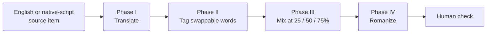

Each test item goes through four phases. This is the pipeline you will run for Telugu.

{}

### Phase I: get a native-language version

- **Math, analogy, decomposition** exist only in English. The authors translated them with the `googletrans` Python library, then had **Claude Sonnet 4.6** clean up the translation, then checked by hand that labels and logic were unchanged.
- **Paraphrase, sentiment, NLI, toxicity** already have native-script versions from AI4Bharat. IndicXParaphrase had no Tamil, so the authors made their own Tamil translations.
- Numbers, `<<2*8=16>>` style calculations, step labels and proper nouns are excluded from translation.

The refinement prompt (Appendix B.2) asks the model to keep step labels and math unchanged, keep names in English, fix word order (SOV), keep the meaning exactly, and sound conversational.

### Phase II: tag every swappable word

Each word that could be swapped is given a category. Per the paper's Table 9:

| Category | What it covers | Swapped at | Example |
|---|---|---|---|
| CAT-0 | Numbers, math, names, abbreviations, step labels | Never | `Step1:`, `#1` |
| CAT-C | Task labels and domain terms | 25%, 50%, 75% | analogy → உவமை (Tamil) |
| CAT-B | Connectors | 50%, 75% | but → लेकिन (Hindi) |
| CAT-D | Concrete topic nouns | 50%, 75% | police → காவல்துறை (Tamil) |
| CAT-A | Small function words | 75% only | a → एक (Hindi) |
| CAT-E | Whole clauses | 75% only | "I cannot give a response" → a full Tamil clause |

Every swap is logged as *English word → Indian word | category | reason*. Across the dataset that produced 33,632 logged swaps.

### Phase III: mix at three levels

Claude Sonnet 4.6 is prompted with the English sentence, its full translation, the category rules and the target level, and outputs the mixed sentence plus the swap log. The authors then checked the outputs by hand.

Mixing is measured with a **Code-Mixing Index (CMI)**: the share of English tokens that were replaced. The paper's targets and the measured averages:

| Level | Target CMI | Measured mean CMI |
|---|---|---|
| 25% | 0.15–0.35 | 0.249 |
| 50% | 0.35–0.60 | 0.294 |
| 75% | 0.60–0.85 | 0.360 |


Only the 25% level lands inside its target. See [issue C3](/docs/issues/critical.html#c3-the-data-misses-its-own-mixing-targets).


### Phase IV: romanize

The native script is converted to English letters using:

- **Aksharantar / IndicXlit** (AI4Bharat's transliteration model),
- **Aksharamukha** (a rule-based script converter),
- ready-made romanized text from **IndicLLMSuite** where available.

Spelling variation (e.g. *ledu* vs *ledhu*) is kept on purpose, because real users spell inconsistently.

### Human check

One or two native speakers per language rated items for **naturalness** on a 1–3 scale (1 = unnatural, 3 = natural). Agreement between the two raters was measured with Cohen's κ. The paper also reports **ChrF**, an automatic score of character overlap with the English source, as a stand-in for fidelity.

{}

## Special cases per task (Appendix B.5)

- **Word analogy:** relation names (*causation*, *affordance*) are CAT-C. Names inside the analogy are never swapped.
- **Math:** all numbers, operators and `<<calc>>` blocks are protected, so math has the lowest mixing of any task.
- **Question decomposition:** step labels are protected. Verbs like *return* and *filter* are CAT-C, and connectors are CAT-B.
- **Toxicity:** the harmful input text is **never mixed**. Only the label and the model's explanation are mixed.
